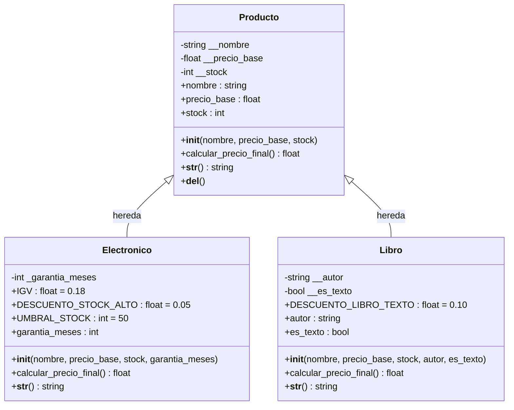

# Sistema de Gestión de Productos

## Información General

**Universidad:** Universidad Nacional del Centro del Perú (UNCP)  
**Facultad:** Ingeniería de Sistemas  
**Curso:** Desarrollo de Aplicaciones Web (IS093A)  
**Práctica:** Semana 10 - Lenguaje Python: POO, Herencia, Polimorfismo  
**Modalidad:** Trabajo Grupal (Máximo 2 integrantes)  
**Fecha:** 2026

### Integrante
SALAZAR ROJAS GABRIEL OMAR 2022200426A

---

## Introducción

El **Sistema de Gestión de Productos** es una aplicación de línea de comandos (CLI) desarrollada en Python que permite administrar un inventario de productos comerciales. El sistema gestiona dos categorías principales: productos electrónicos y libros, cada uno con características y reglas de precio específicas.

Este proyecto es una implementación práctica de los conceptos fundamentales de Programación Orientada a Objetos (POO), demostrando herencia, encapsulamiento, polimorfismo, manejo de excepciones y arquitectura modular.

---

## Objetivos

### Objetivo General
Desarrollar un sistema de gestión de productos que implemente los principios fundamentales de la programación orientada a objetos en Python, permitiendo registrar, consultar y calcular precios de productos mediante una interfaz de consola interactiva.

### Objetivos Específicos
1. Implementar una jerarquía de clases utilizando herencia para modelar diferentes tipos de productos.
2. Aplicar encapsulamiento mediante atributos privados y propiedades decoradas.
3. Demostrar polimorfismo a través de métodos sobrescritos para cálculo de precios.
4. Gestionar errores mediante excepciones personalizadas.
5. Validar datos de entrada garantizando la integridad de la información.
6. Modularizar el código separando responsabilidades en paquetes independientes.
7. Documentar el código y crear pruebas automatizadas.
8. Comprender el Method Resolution Order (MRO) en jerarquías de clases.

---

## Tecnologías Utilizadas

| Tecnología | Versión | Propósito |
|------------|---------|-----------|
| Python | 3.11+ | Lenguaje de programación principal |
| unittest | Estándar | Framework de pruebas unitarias |
| typing | Estándar | Anotaciones de tipos |
| logging | Estándar | Registro de eventos |
| unicodedata | Estándar | Normalización de texto |

**Nota:** El proyecto utiliza únicamente la biblioteca estándar de Python, sin dependencias externas obligatorias.

---

## Estructura del Proyecto

```
gestion-productos/
│
├── main.py                      # Punto de entrada y orquestación del sistema
├── README.md                    # Documentación principal (este archivo)
├── requirements.txt             # Dependencias del proyecto
├── .gitignore                   # Archivos excluidos de control de versiones
│
├── models/                      # Paquete de modelos de negocio
│   ├── __init__.py             # Exportaciones públicas del paquete
│   └── producto.py             # Clases: Producto, Electronico, Libro
│
├── utils/                       # Paquete de utilidades
│   ├── __init__.py             # Exportaciones públicas del paquete
│   ├── exceptions.py           # Excepciones personalizadas
│   └── validators.py           # Funciones de validación
│
├── tests/                       # Suite de pruebas automatizadas
│   ├── __init__.py
│   ├── test_producto.py        # Pruebas de clases de productos
│   ├── test_validators.py      # Pruebas de validadores
│   └── test_cli.py             # Pruebas de interfaz CLI
│
└── evidencias/                  # Evidencias de ejecución
    └── README.md               # Guía para captura de evidencias
```

### Descripción de Componentes

#### `main.py`
Archivo principal que implementa:
- Menú interactivo de usuario
- Gestión del inventario en memoria (diccionario)
- Coordinación de operaciones CRUD
- Manejo estructurado de excepciones (try/except/else/finally)

#### `models/producto.py`
Define la jerarquía de clases de productos:
- **Producto:** Clase base abstracta con atributos comunes
- **Electronico:** Subclase con garantía y reglas de IGV
- **Libro:** Subclase con autor y descuento para libros de texto

#### `utils/exceptions.py`
Excepciones personalizadas del dominio:
- **ValidationError:** Errores de validación de datos
- **NotFoundError:** Recursos no encontrados

#### `utils/validators.py`
Funciones de validación y normalización:
- **validar_numero():** Valida y convierte cadenas a números
- **validar_categoria():** Normaliza nombres de categorías

#### `tests/`
Suite completa de pruebas unitarias con cobertura de:
- Validaciones de atributos
- Cálculos de precios
- Manejo de excepciones
- Funcionalidad del CLI

---

## Arquitectura de Programación Orientada a Objetos

### Diagrama de Clases UML



### Descripción de las Clases

#### Clase `Producto` (Abstracta)

**Propósito:** Clase base que define la interfaz común para todos los productos.

**Atributos Encapsulados:**
- `__nombre` (str): Nombre del producto
- `__precio_base` (float): Precio base antes de impuestos/descuentos
- `__stock` (int): Cantidad disponible en inventario

**Propiedades:**
- `@property nombre` con setter validador
- `@property precio_base` con setter validador
- `@property stock` con setter validador

**Métodos:**
- `calcular_precio_final()`: Método abstracto que debe implementarse en subclases
- `__str__()`: Representación legible del producto
- `__del__()`: Destructor demostrativo (no determinista)

**Validaciones:**
- Nombre no vacío
- Precio mayor que cero, finito, no booleano
- Stock entero no negativo

#### Clase `Electronico` (Concreta)

**Propósito:** Representa productos electrónicos con garantía.

**Herencia:** Extiende `Producto` mediante `super().__init__()`

**Atributos Adicionales:**
- `_garantia_meses` (int): Duración de garantía (mínimo 1 mes)

**Constantes de Clase:**
- `IGV = 0.18`: Impuesto General a las Ventas
- `DESCUENTO_STOCK_ALTO = 0.05`: Descuento por inventario abundante
- `UMBRAL_STOCK = 50`: Límite para aplicar descuento

**Cálculo de Precio:**
```python
precio_con_igv = precio_base * 1.18
if stock > 50:
    precio_final = precio_con_igv * 0.95
else:
    precio_final = precio_con_igv
```

**Ejemplos:**
- Precio base: S/ 100, Stock: 10 → Precio final: S/ 118.00
- Precio base: S/ 100, Stock: 51 → Precio final: S/ 112.10

#### Clase `Libro` (Concreta)

**Propósito:** Representa libros con información del autor.

**Herencia:** Extiende `Producto` mediante `super().__init__()`

**Atributos Adicionales:**
- `__autor` (str): Nombre del autor (privado)
- `__es_texto` (bool): Indica si es libro de texto

**Constantes de Clase:**
- `DESCUENTO_LIBRO_TEXTO = 0.10`: Descuento para libros educativos

**Cálculo de Precio:**
```python
if es_texto:
    precio_final = precio_base * 0.90
else:
    precio_final = precio_base
```

**Ejemplos:**
- Libro general: Precio S/ 100 → Precio final: S/ 100.00
- Libro de texto: Precio S/ 100 → Precio final: S/ 90.00

**Nota Técnica:** El atributo `es_texto` se añadió como ampliación necesaria para implementar la regla de descuento especificada en la guía del docente.

---

## Principios de POO Implementados

### 1. Encapsulamiento

**Implementación:**
- Atributos privados con prefijo doble guion bajo (`__nombre`)
- Atributos protegidos con prefijo simple guion bajo (`_garantia_meses`)
- Acceso controlado mediante decorador `@property`
- Validación en setters para garantizar integridad

**Ejemplo:**
```python
@property
def precio_base(self) -> float:
    return self.__precio_base

@precio_base.setter
def precio_base(self, valor: Union[int, float]) -> None:
    if valor <= 0:
        raise ValidationError("El precio debe ser mayor que cero.")
    self.__precio_base = float(valor)
```

### 2. Herencia

**Jerarquía:**
```
object
  └── Producto
       ├── Electronico
       └── Libro
```

**Uso de `super()`:**
```python
class Electronico(Producto):
    def __init__(self, nombre, precio_base, stock, garantia_meses):
        super().__init__(nombre, precio_base, stock)
        self.garantia_meses = garantia_meses
```

### 3. Polimorfismo

**Implementación:**
Cada subclase sobrescribe `calcular_precio_final()` con su propia lógica:

```python
# Mismo mensaje, diferente comportamiento
productos = [
    Electronico("Laptop", 100, 10, 12),
    Libro("Novela", 100, 10, "Autor", False)
]

for producto in productos:
    precio = producto.calcular_precio_final()  # Polimorfismo
    print(f"{producto.nombre}: S/ {precio}")
```

Resultado:
```
Laptop: S/ 118.0
Novela: S/ 100.0
```

### 4. Abstracción

La clase `Producto` define el contrato (interfaz) pero no implementa `calcular_precio_final()`, obligando a las subclases a proporcionar su lógica específica.

---

## Method Resolution Order (MRO)

### ¿Qué es el MRO?

El **Method Resolution Order** es el orden en que Python busca métodos y atributos en una jerarquía de clases. Define la secuencia de clases que Python recorre cuando se invoca un método.

### MRO en Este Proyecto

#### Clase `Electronico`
```python
>>> Electronico.mro()
[
    <class 'models.producto.Electronico'>,
    <class 'models.producto.Producto'>,
    <class 'object'>
]
```

**Interpretación:**
1. Busca primero en `Electronico`
2. Luego en `Producto` (clase padre)
3. Finalmente en `object` (base de todas las clases)

#### Clase `Libro`
```python
>>> Libro.mro()
[
    <class 'models.producto.Libro'>,
    <class 'models.producto.Producto'>,
    <class 'object'>
]
```

### Funcionamiento de `super()`

`super()` sigue el MRO para llamar al siguiente método en la cadena:

```python
class Electronico(Producto):
    def __init__(self, nombre, precio_base, stock, garantia_meses):
        # super() llama a Producto.__init__() según el MRO
        super().__init__(nombre, precio_base, stock)
        self.garantia_meses = garantia_meses
```

### Herencia vs Composición

**Decisión de Diseño:** Se eligió herencia porque:
- Los productos electrónicos y libros **son** productos (relación "es-un")
- Comparten atributos y comportamiento común
- Existe una jerarquía conceptual natural

**Cuándo usar Composición:**
- Relaciones "tiene-un" en lugar de "es-un"
- Ejemplo: `Producto` tiene un `Proveedor` (composición)
- Necesidad de combinar comportamientos de múltiples fuentes sin relación jerárquica
- Evitar problemas de herencia múltiple compleja

---

## Reglas de Negocio

### Productos Electrónicos

1. **Impuesto General a las Ventas (IGV):**
   - Se aplica 18% sobre el precio base
   - Fórmula: `precio_con_igv = precio_base × 1.18`

2. **Descuento por Stock Alto:**
   - Condición: `stock > 50` (estrictamente mayor)
   - Descuento: 5% sobre el precio con IGV
   - Fórmula: `precio_final = precio_con_igv × 0.95`
   - **Nota:** El valor 5% es un supuesto de implementación, ya que la guía no especificaba el porcentaje exacto.

3. **Garantía:**
   - Mínimo: 1 mes
   - Debe ser un entero positivo

### Libros

1. **Descuento para Libros de Texto:**
   - Condición: `es_texto == True`
   - Descuento: 10% sobre el precio base
   - Fórmula: `precio_final = precio_base × 0.90`

2. **Libros Generales:**
   - Sin descuentos ni impuestos adicionales
   - `precio_final = precio_base`

3. **Validaciones:**
   - Autor obligatorio (no vacío)
   - `es_texto` debe ser booleano

### Validaciones Generales

| Campo | Validación |
|-------|------------|
| Nombre | Cadena no vacía |
| Precio Base | Número > 0, finito, no booleano |
| Stock | Entero ≥ 0 |
| Garantía | Entero ≥ 1 |
| Autor | Cadena no vacía |
| Categoría | "Electronico" o "Libro" |

---

## Instalación y Ejecución

### Requisitos Previos

- **Python 3.11 o superior**
- Sistema operativo: Windows 11, Linux o macOS
- Terminal: PowerShell, CMD o Bash

### Verificar Instalación de Python

```bash
python --version
```

Salida esperada: `Python 3.11.x` o superior

### Clonar o Descargar el Proyecto

```bash
# Opción 1: Clonar desde Git (si está en repositorio)
git clone [URL_REPOSITORIO]
cd gestion-productos

# Opción 2: Descomprimir archivo ZIP
# Extraer y navegar a la carpeta del proyecto
```

### Ejecutar el Sistema

```bash
# Desde el directorio raíz del proyecto
python main.py
```

### Ejecución desde VS Code

1. Abrir la carpeta del proyecto en VS Code
2. Abrir el archivo `main.py`
3. Presionar `F5` o hacer clic en "Run Python File"
4. Interactuar con el programa en la terminal integrada

---

## Manual de Usuario

### Opción 1: Agregar Producto

Permite registrar un nuevo producto en el inventario.

**Flujo:**
1. Seleccionar categoría (`Electronico` o `Libro`)
2. Ingresar datos comunes: nombre, precio base, stock
3. Ingresar datos específicos según categoría
4. El sistema asigna un ID único automáticamente

**Ejemplo - Electrónico:**
```
Opción > 1
Categoría (Electronico/Libro): Electronico
Nombre: Laptop HP Pavilion
Precio base (S/): 2500
Stock: 10
Garantía en meses: 12

✓ Producto registrado correctamente.
  ID asignado: 1
```

**Ejemplo - Libro:**
```
Opción > 1
Categoría (Electronico/Libro): Libro
Nombre: Cien Años de Soledad
Precio base (S/): 80
Stock: 25
Autor: Gabriel García Márquez
¿Es libro de texto? (s/n): n

✓ Producto registrado correctamente.
  ID asignado: 2
```

### Opción 2: Listar Productos

Muestra todos los productos registrados en el inventario.

**Ejemplo:**
```
Opción > 2

--- INVENTARIO ---

Total de productos: 2

ID: 1 | [Electronico] Laptop HP Pavilion | S/ 2500.00 | Stock: 10 | Garantía: 12 meses
ID: 2 | [Libro] Cien Años de Soledad | S/ 80.00 | Stock: 25 | Autor: Gabriel García Márquez | Tipo: Libro general
```

**Inventario Vacío:**
```
--- INVENTARIO ---
No hay productos registrados.
```

### Opción 3: Calcular Precio Final

Calcula y muestra el precio final de un producto aplicando las reglas de negocio.

**Ejemplo:**
```
Opción > 3
Ingrese el ID del producto: 1

==================================================
=== CÁLCULO DE PRECIO FINAL ===
==================================================
ID: 1
Producto: Laptop HP Pavilion
Categoría: Electronico
Precio base: S/ 2500.00
Precio final: S/ 2950.00
==================================================
```

**Cálculo Detallado:**
- Precio base: S/ 2500.00
- IGV (18%): S/ 450.00
- Subtotal: S/ 2950.00
- Stock: 10 (≤ 50, sin descuento adicional)
- **Precio final: S/ 2950.00**

### Opción 4: Salir

Cierra el sistema de forma segura.

```
Opción > 4

==================================================
Cerrando sistema...
Gracias por utilizar el Sistema de Gestión de Productos.
==================================================
```

---

## Manejo de Excepciones

El sistema implementa un manejo robusto de errores mediante excepciones personalizadas y la estructura `try/except/else/finally`.

### Excepciones Personalizadas

#### `ValidationError`

**Cuándo se lanza:**
- Datos de entrada inválidos
- Valores fuera de rango
- Tipos de datos incorrectos

**Ejemplo:**
```
Precio base (S/): -100

✗ Error de validación: El valor debe ser mayor o igual a 0.01.
```

**Casos que generan ValidationError:**
- Nombre vacío
- Precio negativo, cero, NaN o infinito
- Stock negativo o decimal
- Garantía menor a 1 mes
- Autor vacío
- Categoría inválida
- Opción de menú inválida

#### `NotFoundError`

**Cuándo se lanza:**
- Búsqueda de producto con ID inexistente

**Ejemplo:**
```
Ingrese el ID del producto: 999

✗ No encontrado: No existe un producto con ID 999.
```

### Estructura try/except/else/finally

El bucle principal del sistema utiliza las cuatro cláusulas:

```python
while True:
    try:
        # Código que puede lanzar excepciones
        opcion = input("Opción > ")
        # ... procesar opción ...
    
    except ValidationError as e:
        # Manejar errores de validación
        print(f"✗ Error de validación: {e.message}")
    
    except NotFoundError as e:
        # Manejar recursos no encontrados
        print(f"✗ No encontrado: {e.message}")
    
    except (EOFError, KeyboardInterrupt):
        # Manejar interrupciones del usuario
        print("\nInterrupción detectada. Cerrando sistema...")
        break
    
    except Exception as e:
        # Capturar errores inesperados
        logging.exception("Error inesperado")
        print(f"✗ Error inesperado: {type(e).__name__}")
    
    else:
        # Se ejecuta si no hubo excepciones
        # (En este diseño, los mensajes ya se muestran en las funciones)
        pass
    
    finally:
        # Se ejecuta siempre, útil para limpieza
        # (Disponible para extensiones futuras)
        pass
```

### Beneficios del Manejo de Excepciones

1. **Robustez:** El sistema continúa operando después de errores recuperables
2. **Claridad:** Mensajes específicos para cada tipo de error
3. **Separación:** Lógica de negocio separada de manejo de errores
4. **Trazabilidad:** Errores inesperados se registran con `logging`

---

## Pruebas Automatizadas

El proyecto incluye una suite completa de pruebas unitarias desarrolladas con `unittest`.

### Ejecutar Todas las Pruebas

```bash
python -m unittest discover -s tests -v
```

### Ejecutar Pruebas Específicas

```bash
# Pruebas de productos
python -m unittest tests.test_producto -v

# Pruebas de validadores
python -m unittest tests.test_validators -v

# Pruebas del CLI
python -m unittest tests.test_cli -v
```

### Cobertura de Pruebas

#### `test_producto.py` - 40 pruebas

**TestProducto (17 pruebas):**
- Creación válida de productos
- Validación de nombre vacío
- Validación de precio (negativo, cero, NaN, infinito, booleano)
- Validación de stock (negativo, decimal, cero válido)
- Funcionamiento de setters
- Representación en cadena
- Método abstracto

**TestElectronico (13 pruebas):**
- Verificación de herencia
- Inicialización con `super()`
- Validación de garantía (válida, mínima, cero, negativa)
- Cálculo de precio con IGV
- Cálculo con diferentes niveles de stock (bajo, umbral, alto)
- Aplicación correcta de descuento
- Representación con garantía

**TestLibro (10 pruebas):**
- Verificación de herencia
- Validación de autor (válido, vacío, espacios)
- Encapsulamiento de atributo privado
- Cálculo de precio (normal, libro de texto)
- Valor por defecto de `es_texto`
- Validación de tipo booleano
- Representación con autor y tipo

#### `test_validators.py` - 27 pruebas

**TestValidarNumero (17 pruebas):**
- Conversión a entero y float
- Rechazo de negativos
- Cadenas no numéricas
- Validación de rangos (inferior, superior, dentro)
- NaN e infinito
- Límites exactos
- Floats con muchos decimales
- Cadenas vacías y con espacios

**TestValidarCategoria (10 pruebas):**
- Normalización de mayúsculas/minúsculas
- Manejo de tildes
- Categorías mixtas
- Categorías inválidas y vacías
- Espacios alrededor
- Múltiples variaciones

#### `test_cli.py` - 16 pruebas

**TestAgregarProducto (5 pruebas):**
- Registro exitoso de electrónico
- Registro exitoso de libro general y de texto
- Categoría inválida
- Precio negativo

**TestListarProductos (3 pruebas):**
- Inventario vacío
- Inventario con productos
- Formato del listado

**TestCalcularPrecioProducto (4 pruebas):**
- Cálculo de producto existente
- Producto inexistente (NotFoundError)
- ID no numérico
- ID negativo

**TestSolicitudDatosComunes (3 pruebas):**
- Datos válidos
- Nombre vacío
- Precio no numérico

**TestMenuPrincipal (3 pruebas):**
- Salida normal del programa
- Opción inválida
- Listado desde menú

### Resultados Esperados

Al ejecutar las pruebas correctamente, debería ver:

```
test_autor_valido (tests.test_producto.TestLibro) ... ok
test_calculo_precio_base (tests.test_producto.TestElectronico) ... ok
test_creacion_valida (tests.test_producto.TestProducto) ... ok
test_electronico_minusculas (tests.test_validators.TestValidarCategoria) ... ok
test_entero_valido (tests.test_validators.TestValidarNumero) ... ok
...

----------------------------------------------------------------------
Ran 83 tests in X.XXXs

OK
```

**Total de Pruebas:** 83 pruebas unitarias  
**Estado Esperado:** Todas aprobadas (OK)

---

## Evidencias de Ejecución

Las tres evidencias requeridas por la guía están documentadas en `evidencias/README.md`:

### Evidencia 1: Caso Exitoso ✓
- Registro de producto
- Cálculo de precio final
- Demostración de funcionalidad completa

### Evidencia 2: ValidationError ✓
- Ingreso de datos inválidos
- Captura de excepción de validación
- Mensaje de error descriptivo

### Evidencia 3: NotFoundError ✓
- Búsqueda de ID inexistente
- Captura de excepción de recurso no encontrado
- Mensaje de error específico

**Instrucciones:** Consulte `evidencias/README.md` para los pasos detallados de captura.

---

## Justificación de Decisiones Técnicas

### 1. Arquitectura Modular

**Decisión:** Separar el código en paquetes (`models`, `utils`, `tests`)

**Justificación:**
- **Mantenibilidad:** Cada módulo tiene una responsabilidad clara
- **Reutilización:** Los validadores pueden usarse en otros proyectos
- **Escalabilidad:** Fácil agregar nuevas categorías de productos
- **Testabilidad:** Las pruebas se organizan según componentes

### 2. Encapsulamiento Estricto

**Decisión:** Usar atributos privados con doble guion bajo

**Justificación:**
- **Integridad:** Garantiza validación en toda modificación
- **Seguridad:** Previene acceso directo sin control
- **Académico:** Demuestra comprensión de encapsulamiento real
- **PEP 8:** Sigue convenciones de Python para atributos privados

### 3. Propiedades en Lugar de Getters/Setters Tradicionales

**Decisión:** Usar decorador `@property`

**Justificación:**
- **Pythónico:** Sintaxis más natural (`producto.nombre` en lugar de `producto.get_nombre()`)
- **Retrocompatibilidad:** Puede agregarse validación sin cambiar interfaz
- **Legibilidad:** Código más limpio y expresivo

### 4. Validación Centralizada

**Decisión:** Funciones de validación en módulo separado

**Justificación:**
- **DRY:** Evita duplicación de lógica de validación
- **Consistencia:** Mismas reglas en todo el sistema
- **Testabilidad:** Validadores probables independientemente
- **Reutilización:** Fácil usar en otros módulos

### 5. Excepciones Personalizadas

**Decisión:** Crear `ValidationError` y `NotFoundError`

**Justificación:**
- **Semántica:** Nombres expresivos del error específico
- **Captura Selectiva:** Permite manejar cada tipo diferenciadamente
- **Documentación:** Autodocumenta tipos de errores posibles
- **Extensibilidad:** Fácil agregar más tipos si es necesario

### 6. Inventario como Diccionario

**Decisión:** Usar `Dict[int, Producto]` en lugar de lista

**Justificación:**
- **Acceso O(1):** Búsqueda por ID en tiempo constante
- **IDs Únicos:** Las claves garantizan unicidad
- **Flexibilidad:** Fácil eliminar productos sin reindexar
- **Simplicidad:** No requiere búsqueda secuencial

### 7. Constantes de Clase para Reglas de Negocio

**Decisión:** Definir `IGV`, `DESCUENTO_STOCK_ALTO`, etc. como constantes

**Justificación:**
- **Mantenibilidad:** Un solo lugar para cambiar valores
- **Legibilidad:** Nombres descriptivos en lugar de "números mágicos"
- **Documentación:** Auto-explica el significado de cada valor
- **Consistencia:** Todos los cálculos usan los mismos valores

### 8. Docstrings Completos

**Decisión:** Documentar todas las clases, métodos y funciones

**Justificación:**
- **Académico:** Demuestra buenas prácticas de documentación
- **Mantenibilidad:** Otros desarrolladores entienden el código
- **Help Integrado:** `help(Producto)` muestra documentación
- **Rúbrica:** Cumple criterio de documentación (20%)

### 9. Anotaciones de Tipos

**Decisión:** Usar `typing` para tipos de parámetros y retorno

**Justificación:**
- **Claridad:** Explícita qué tipos se esperan
- **Detección Temprana:** IDEs pueden detectar errores de tipo
- **Documentación:** Complementa los docstrings
- **Modernidad:** Sigue estándares actuales de Python

### 10. Uso de `super()` sin Argumentos

**Decisión:** `super().__init__()` en lugar de `Producto.__init__(self)`

**Justificación:**
- **Pythónico:** Sintaxis moderna de Python 3
- **MRO:** Respeta el orden de resolución de métodos
- **Flexibilidad:** Funciona correctamente con herencia múltiple
- **Recomendado:** PEP 3135

---

## Decisiones Sobre Supuestos No Especificados

### Porcentaje de Descuento por Stock Alto

**Requisito Original:** "Aplicar un descuento si el stock es mayor que 50"

**Supuesto Implementado:** Descuento del 5%

**Justificación:**
- El porcentaje no se especificó en la guía
- 5% es un valor comercial razonable
- Se documentó expresamente como supuesto
- Fácilmente modificable mediante la constante `DESCUENTO_STOCK_ALTO`

### Atributo `es_texto` en Libros

**Requisito Original:** "Precio base - 10% si es libro de texto"

**Supuesto Implementado:** Añadir parámetro `es_texto: bool = False`

**Justificación:**
- Necesario para distinguir libros de texto de otros libros
- No rompe compatibilidad (valor por defecto)
- Permite implementar la regla del docente
- Alternativa sería inferir del nombre, pero es menos robusto

### Umbral de Stock

**Requisito Original:** "Stock mayor que 50"

**Interpretación:** Estrictamente mayor (`>`) no mayor o igual (`>=`)

**Justificación:**
- La redacción "mayor que" implica exclusión del límite
- Stock de exactamente 50 NO recibe descuento
- Stock de 51 o más SÍ recibe descuento
- Probado explícitamente en tests

---

## Conclusiones

### Sobre Programación Orientada a Objetos

1. **Herencia:** Permite modelar relaciones "es-un" de forma natural, facilitando la reutilización de código y la extensibilidad del sistema.

2. **Encapsulamiento:** El uso de atributos privados y propiedades garantiza la integridad de los datos, previniendo estados inválidos y centralizando la lógica de validación.

3. **Polimorfismo:** Habilita el tratamiento uniforme de objetos diferentes, permitiendo que cada clase defina su comportamiento específico sin alterar el código cliente.

4. **MRO:** Comprender el orden de resolución de métodos es fundamental para usar correctamente `super()` y entender el flujo de ejecución en jerarquías de clases.

### Sobre Modularización

5. **Separación de Responsabilidades:** Dividir el código en paquetes (`models`, `utils`, `tests`) mejora significativamente la mantenibilidad y facilita el trabajo en equipo.

6. **Validación Centralizada:** Tener funciones de validación reutilizables reduce duplicación y garantiza consistencia en toda la aplicación.

### Sobre Manejo de Errores

7. **Excepciones Personalizadas:** Crear excepciones específicas del dominio mejora la expresividad del código y facilita el manejo diferenciado de errores.

8. **Estructura try/except/else/finally:** El manejo estructurado de excepciones permite crear aplicaciones robustas que responden adecuadamente a situaciones excepcionales sin interrumpir el flujo normal.

### Sobre Pruebas Automatizadas

9. **Confianza en el Código:** Las 83 pruebas unitarias proporcionan confianza en la corrección del sistema y detectan regresiones al realizar cambios.

10. **Documentación Ejecutable:** Las pruebas documentan el comportamiento esperado de forma verificable y actualizable.

### Sobre Buenas Prácticas

11. **PEP 8:** Seguir las convenciones de estilo de Python mejora la legibilidad y facilita la colaboración.

12. **Documentación:** Los docstrings, comentarios y este README son esenciales para que otros (incluido uno mismo en el futuro) comprendan el código.

13. **Anotaciones de Tipos:** Agregar hints de tipos mejora la comprensión del código y habilita herramientas de análisis estático.

### Reflexión Final

Este proyecto demuestra que la programación orientada a objetos no es solo una técnica de codificación, sino una forma de pensar y modelar problemas del mundo real. La combinación de POO con modularización, validación robusta, manejo de excepciones y pruebas automatizadas resulta en software mantenible, extensible y confiable.

Los principios aplicados aquí son fundamentales para el desarrollo profesional de software y aplicables a proyectos de cualquier escala.

---

## Referencias y Recursos

### Documentación Oficial

- **Python 3.11 Documentation:** https://docs.python.org/3.11/
- **PEP 8 – Style Guide for Python Code:** https://peps.python.org/pep-0008/
- **PEP 484 – Type Hints:** https://peps.python.org/pep-0484/
- **unittest – Unit testing framework:** https://docs.python.org/3/library/unittest.html

### Conceptos Aplicados

- **Object-Oriented Programming in Python:** https://realpython.com/python3-object-oriented-programming/
- **Python Properties:** https://docs.python.org/3/library/functions.html#property
- **Python super():** https://docs.python.org/3/library/functions.html#super
- **Python Exceptions:** https://docs.python.org/3/tutorial/errors.html

### Guía Original

- **Semana 10 - Desarrollo de Aplicaciones Web (IS093A)**
- Universidad Nacional del Centro del Perú
- Facultad de Ingeniería de Sistemas

---

## Licencia

Este proyecto es material académico desarrollado para fines educativos en el marco del curso IS093A de la UNCP.

---

## Contacto

Para consultas sobre este proyecto, contactar a los integrantes del grupo:

- **[Integrante 1]:** [email]
- **[Integrante 2]:** [email]

---

**Universidad Nacional del Centro del Perú**  
**Facultad de Ingeniería de Sistemas**  
**2026**
